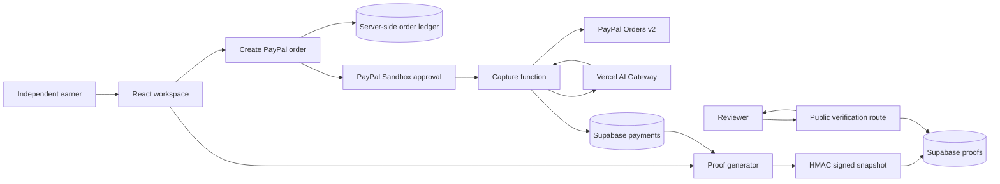

# Architecture

## Trust boundaries

- The browser can request operations but cannot access Supabase tables directly.
- PayPal is the source of capture status, amount, currency, payer, refund, and dispute evidence.
- The order ledger preserves the merchant-declared client label and service description across redirect/capture boundaries.
- AI can classify and explain evidence; it cannot create or alter PayPal capture facts.
- Proof verification recomputes the snapshot signature and checks active/expiry state.

## Classification approach

Statable sends a bounded, privacy-minimized payment record plus recent history to AI Gateway. The response must satisfy a Zod schema containing a fixed classification, confidence, short explanation, and evidence list. If Gateway is unavailable, deterministic rules remain operational and the record explicitly shows fallback status.
